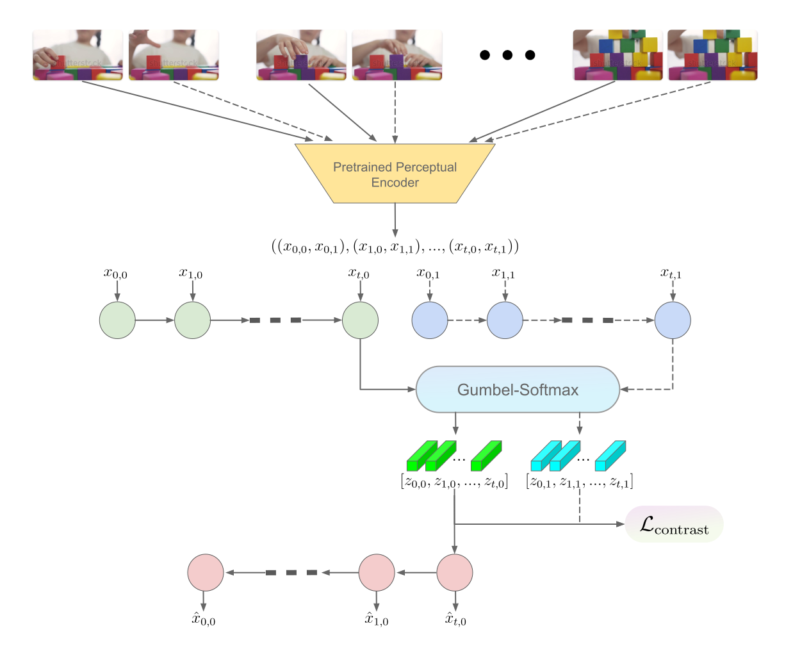

# Toward Learning Symbolic Representations from Video

## Abstract

This research investigates the extraction of state representations from videos, addressing a key challenge in computer vision: learning representations that align with symbolic planning. Typically, representations derived from deep learning models are incompatible with the symbolic structures utilized by classical planning methods. To bridge this gap, this study introduces a novel approach to extract propositional representations directly from video data by leveraging perceptual autoencoders—pretrained representation-learning models employed within Latent Diffusion Models (LDM). The proposed method utilizes a pretrained encoder to generate semantically compressed embeddings for individual video frames to be used as inputs. Subsequently, to achieve representations compatible with symbolic planning, we train an autoencoder specifically designed to produce binary representations from these semantic embeddings, capturing visual features in a compact, discrete form. The architecture of this autoencoder supports the extraction of high-level symbolic information. Ultimately, this framework aims to explore the capabilities and limitations of vision-based neural networks in learning representations conducive to symbolic planning directly from video data.

<p align="center">
  
</p>

## Contents

- [Repository Structure](#repository-structure)
- [Setup](#setup)
  - [1. Prerequisites](#1-prerequisites)
  - [2. Clone the repository](#2-clone-the-repository)
  - [3. Create the Python environment](#3-create-the-python-environment)
  - [4. Install dependencies](#4-install-dependencies)
  - [5. Download the Stable Diffusion checkpoint](#5-download-the-stable-diffusion-checkpoint)
  - [6. Download the videos and trained models](#6-download-the-videos-and-trained-models)
- [Usage](#usage)
  - [Extracting frames](#extracting-frames)
  - [Computing perceptual embeddings](#computing-perceptual-embeddings)
  - [Transition flags](#transition-flags)
  - [Training](#training)
  - [Hyperparameter sweeps](#hyperparameter-sweeps)
  - [Evaluation](#evaluation)
- [Troubleshooting](#troubleshooting)

## Repository Structure

```
symbols-from-video/
├── models/
│   ├── contrastive_RBVAE/     # RBVAE trained on pixels (reconstruction + KL + pairwise contrastive loss)
│   ├── percep_RBVAE/          # Same objective, trained on precomputed perceptual (LDM) embeddings
│   ├── triplet_RBVAE/         # Experimental: triplet margin loss in place of the pairwise contrastive loss
│   └── simple_RBVAE/          # Early baseline: reconstruction + KL only (contrast_loss is defined but unused)
├── scripts/
│   ├── *_frame_extraction.py  # Split videos into individual frames
│   ├── download_weights.py    # Download the Stable Diffusion v1.4 checkpoint
│   └── evaluation/
│       ├── best_models.txt    # Latent dimensions of the best models per video
│       ├── clustering_eval/          # UMAP / Hamming distance analysis of binary embeddings
│       ├── linear_projection_eval/   # Linear regression probe on embeddings
│       └── state_consistency_eval/   # State consistency under perturbations
├── src/stable-diffusion/      # Latent Diffusion code (perceptual encoder) + get_percep_embeddings.py
├── videos/
│   └── frames/transition_flags.txt   # Ground-truth state transitions per video
├── requirements.txt
└── setup.py
```

## Setup

### 1. Prerequisites

- **OS:** Linux (x86_64). The project was developed on Linux, and the pinned dependencies target it. macOS and Windows are not supported.
- **GPU:** An NVIDIA GPU with a driver that supports **CUDA 11.8** (driver version >= 520). The code falls back to the CPU automatically if no GPU is found, but training and computing embeddings will be very slow.
- **Conda** ([Miniconda](https://docs.conda.io/en/latest/miniconda.html) or Anaconda) and **git**.
- **Disk space:** ~5 GB for the Stable Diffusion checkpoint, plus space for videos, extracted frames and embeddings.
- **Accounts (optional):**
  - [Hugging Face](https://huggingface.co/) — needed to download the Stable Diffusion checkpoint.
  - [Weights & Biases](https://wandb.ai/) — only needed for hyperparameter sweeps.

### 2. Clone the repository

```bash
git clone https://github.com/matt-suncy/symbols-from-video.git
cd symbols-from-video
```

All commands below are run from the repository root unless stated otherwise.

### 3. Create the Python environment

The project targets **Python 3.8.5**.

```bash
conda create -n symbols-from-video python=3.8.5 -y
conda activate symbols-from-video
python -m pip install --upgrade "pip>=23.1"
```

### 4. Install dependencies

Install everything with a single command from the repository root:

```bash
pip install -r requirements.txt
```

What this does:

- **PyTorch:** `requirements.txt` adds the PyTorch CUDA 11.8 package index, so pip installs `torch==2.3.0+cu118` (plus `torchvision`/`torchaudio`) together with the matching NVIDIA runtime libraries. You only need an NVIDIA driver, not a system CUDA toolkit.
- **Git dependencies:** [CLIP](https://github.com/openai/CLIP) and [taming-transformers](https://github.com/CompVis/taming-transformers) are installed from pinned commits.
- **Local packages:** the Latent Diffusion code in `src/stable-diffusion` (the `ldm` package) and this project are installed in editable mode.

> **Why `editable_mode=compat`?** `taming-transformers` and the vendored `ldm` code are missing `__init__.py` files. With modern setuptools, a regular editable install of them succeeds but `import ldm` / `import taming` then fails. Compat mode puts their source directories on `sys.path` instead, which is why the requirements need pip >= 23.1.

> **Note:** In a conda environment, pip clones the editable `taming-transformers` checkout into `./src/taming-transformers`, inside this repository. That folder is git-ignored. The install may also rewrite the tracked `src.egg-info/` metadata; you can discard those changes with `git checkout -- src.egg-info`.

**d) Verify the installation:**

```bash
python -c "import torch, ldm, taming, clip; from ldm.models.autoencoder import AutoencoderKL; print('torch', torch.__version__, '| CUDA available:', torch.cuda.is_available())"
```

### 5. Download the Stable Diffusion checkpoint

The pretrained perceptual encoder is the autoencoder from Stable Diffusion v1.4. The scripts expect the checkpoint at:

```
src/stable-diffusion/models/ldm/stable-diffusion-v1/model.ckpt
```

The checkpoint is gated on Hugging Face, so first accept the license on the [model page](https://huggingface.co/CompVis/stable-diffusion-v-1-4-original) and log in:

```bash
huggingface-cli login
```

Then download it into place:

```bash
mkdir -p src/stable-diffusion/models/ldm/stable-diffusion-v1
huggingface-cli download CompVis/stable-diffusion-v-1-4-original sd-v1-4.ckpt \
    --local-dir src/stable-diffusion/models/ldm/stable-diffusion-v1
mv src/stable-diffusion/models/ldm/stable-diffusion-v1/sd-v1-4.ckpt \
   src/stable-diffusion/models/ldm/stable-diffusion-v1/model.ckpt
```

> Alternatively, `python scripts/download_weights.py` downloads the same file into your Hugging Face cache (`~/.cache/huggingface/hub`); copy or symlink it to the path above.

### 6. Download the videos and trained models

The extracted video frames and the trained model weights are available on Google Drive:
https://drive.google.com/drive/folders/1RWonm0SOELsXIRCMIL7Ou1CyitJtQZLC?usp=sharing

```
<Drive folder>/
├── assembly101-frames/frames/       # 0000000000.jpg, 0000000001.jpg, ...
├── blocks-frames/frames/
├── chinese-chess-frames/frames/
├── ikeaasm-frames/frames/
└── model_weights/
    ├── trained_on_pixels/           # contrastive_RBVAE checkpoints
    │   └── best_{assembly101,blocks,chin_chess,ikeaasm}_model.pt
    └── trained_on_embeddings/       # percep_RBVAE checkpoints
        └── best_{assembly101,blocks,chin_chess,ikeaasm}_model.pt
```

Download through the browser, or with `gdown` (installed with the requirements). Large folders may hit Google Drive's rate limits, in which case download them in the browser instead:

```bash
gdown --folder https://drive.google.com/drive/folders/1RWonm0SOELsXIRCMIL7Ou1CyitJtQZLC -O downloads/
```

**Frames.** Move each `frames/` folder to `videos/frames/<name>/`. With the names below, the default paths already in the scripts work without editing:

| Drive folder | Move to | Default path used by |
| --- | --- | --- |
| `ikeaasm-frames/frames` | `videos/frames/ikea_asm_table/` | `contrastive_RBVAE_train.py`, evaluation scripts |
| `assembly101-frames/frames` | `videos/frames/C10118_rgb/` | `percep_RBVAE_train.py`, `contrastive_RBVAE_wandb_sweep.py` |
| `chinese-chess-frames/frames` | `videos/frames/chin_chess/` | `get_percep_embeddings.py`, `percep_RBVAE_wandb_sweep.py` |
| `blocks-frames/frames` | `videos/frames/kid_playing_with_blocks_1.mp4/` | `triplet_RBVAE`, `simple_RBVAE` |

(The sweep scripts and `get_percep_embeddings.py` use absolute `/home/jovyan/...` paths, so for those you still need to change the prefix to your checkout.)

**Perceptual embeddings** (`*_perceps.npy`) are not on the Drive. Generate them from the frames as described in [Computing perceptual embeddings](#computing-perceptual-embeddings).

**Trained models.** Copy the weights into `scripts/evaluation/best_models/`, keeping the two subfolders:

```
scripts/evaluation/best_models/
├── trained_on_pixels/best_<video>_model.pt
└── trained_on_embeddings/best_<video>_model.pt
```

[`scripts/evaluation/best_models.txt`](scripts/evaluation/best_models.txt) lists the `latent_dim` for each model; you need it to construct the model before loading the weights. See [Evaluation](#evaluation) for how to point the evaluation scripts at these files.

Frames, videos, model weights and the SD checkpoint (`*.jpg`, `*.mp4`, `*.pt`, `*.ckpt`) and `scripts/evaluation/best_models/` are git-ignored. `*.npy` embedding files are **not** ignored, so don't commit them by accident.

## Usage

> **Note:** Most scripts configure their data paths, transition flags and hyperparameters in the `if __name__ == "__main__":` block at the bottom of the file rather than through command-line arguments. Before running a script, open it and update those values for the video you are working with. Some scripts still contain absolute paths from the original development machine (e.g. `/home/jovyan/...`) that must be changed.

### Extracting frames

Skip this if you downloaded pre-extracted frames. Otherwise, set `video_path` and `frames_dir` at the bottom of [`scripts/decord_frame_extraction.py`](scripts/decord_frame_extraction.py) and run:

```bash
python scripts/decord_frame_extraction.py
```

Frames are written to `<frames_dir>/<video filename>/` with the 10-digit naming the training code expects. [`scripts/cv2_frame_extraction.py`](scripts/cv2_frame_extraction.py) is an OpenCV-based alternative that produces the same naming.

### Computing perceptual embeddings

The perceptual RBVAE and most evaluation scripts use embeddings from the pretrained Stable Diffusion encoder rather than raw pixels. These embeddings are not on the Drive, so you need to compute them (this requires the [SD checkpoint](#5-download-the-stable-diffusion-checkpoint)). Set `IMAGE_FOLDER` in [`src/stable-diffusion/get_percep_embeddings.py`](src/stable-diffusion/get_percep_embeddings.py) to the absolute path of a frames folder, then run:

```bash
python src/stable-diffusion/get_percep_embeddings.py
mv <folder_name>_perceps.npy videos/
```

The script writes `<folder_name>_perceps.npy` to the current working directory. `<folder_name>` is the last component of `IMAGE_FOLDER`; for example, `videos/frames/ikea_asm_table` produces `ikea_asm_table_perceps.npy`, which is the file the evaluation scripts expect. The file is a pickled dictionary mapping each frame filename (`0000000000.jpg`, ...) to its 4-channel latent embedding.

### Transition flags

[`videos/frames/transition_flags.txt`](videos/frames/transition_flags.txt) lists, for each video, the ground-truth frames where the scene changes state:

```
chinese_chess:
[74, 206, 282, 389], last_frame = 479, grey_out = 10
```

- **flags** — frame indices at which a state transition occurs.
- **last_frame** — index of the final frame of the video.
- **grey_out** — number of frames on each side of a transition that are excluded from every state, since they are ambiguous mid-transition frames.

Copy these values into the `flags`, `last_frame` and `grey_out` variables of the training/evaluation script you are running.

### Training

Run each training script from inside its own directory, because it imports its model module by bare name (e.g. `from contrastive_RBVAE_model import ...`):

```bash
# RBVAE trained on pixels (defaults to IKEA ASM frames)
cd models/contrastive_RBVAE
python contrastive_RBVAE_train.py

# RBVAE trained on perceptual embeddings (defaults to Assembly101: videos/C10118_rgb_perceps.npy)
cd models/percep_RBVAE
python percep_RBVAE_train.py
```

Each script's `__main__` block sets the data path, transition flags, `latent_dim`, `batch_size` and `num_epochs`. The best checkpoint (by validation state consistency) is saved as a single file named `saved_RBVAE` in the script's directory. It is a dictionary with a `model_state_dict` key. Training curves are logged to `./runs`; view them with:

```bash
tensorboard --logdir=runs
```

The experimental `triplet_RBVAE` reuses the contrastive model definition, so put that directory on the path when running it:

```bash
cd models/triplet_RBVAE
PYTHONPATH=../contrastive_RBVAE python triplet_RBVAE_train.py
```

### Hyperparameter sweeps

Sweeps use Weights & Biases. Log in once with `wandb login`. In the sweep script, change the absolute `FRAMES_PATH` / `EMBEDDINGS_PATH` constants at the top to your checkout, and set the fixed parameters (`flags`, `last_frame`, `grey_out`) in `sweep_config`. Then create a sweep:

```bash
cd models/percep_RBVAE
python percep_RBVAE_wandb_sweep.py --create_sweep --project_name percep-rbvae
```

To add more agents to an existing sweep (e.g. from another GPU or machine):

```bash
python percep_RBVAE_wandb_sweep.py --sweep_id <SWEEP_ID> --project_name percep-rbvae
```

`models/contrastive_RBVAE/contrastive_RBVAE_wandb_sweep.py` works the same way (default project name `contrastive-rbvae`). Each run saves its checkpoint to `models/model_<run name>.pt` and its TensorBoard logs to `runs/<run name>/`, inside the model's directory.

### Evaluation

The evaluation scripts compare the pixel-trained and embedding-trained models on one video. As committed, they are set up for **IKEA ASM**: they need

- the frames in `videos/frames/ikea_asm_table/`,
- the embeddings in `videos/ikea_asm_table_perceps.npy` ([how to compute them](#computing-perceptual-embeddings)), and
- models with `latent_dim = 50` for both (matching [`best_models.txt`](scripts/evaluation/best_models.txt)).

The model paths in the scripts still refer to the original sweep run names (`best_models/pixels/best_model_rare-sweep-12.pt` and `best_models/perceps/best_model_fresh-sweep-9.pt`). Update `contrastive_model_path` / `percep_model_path` (named `contrastive_path` / `percep_path` in `embedding_matching.py`) to the Drive weights:

```python
"scripts/evaluation/best_models/trained_on_pixels/best_ikeaasm_model.pt"      # contrastive (pixels)
"scripts/evaluation/best_models/trained_on_embeddings/best_ikeaasm_model.pt"  # perceptual (embeddings)
```

To evaluate another video, also change `frames_dir`, the embeddings path, `flags` / `last_frame` / `grey_out` and both `latent_dim` values. Then run from the repository root:

```bash
# UMAP, t-SNE and PCA plots of the binary embeddings, coloured by state
python scripts/evaluation/clustering_eval/embedding_umap.py

# Hamming distances between binary embeddings of different states
python scripts/evaluation/clustering_eval/embedding_hamming_distance.py

# State consistency of embeddings under image perturbations (also loads the SD checkpoint)
python scripts/evaluation/state_consistency_eval/embedding_matching.py
```

Plots and CSVs are written next to each script.

[`linear_projection_eval/linear_regression_eval.py`](scripts/evaluation/linear_projection_eval/linear_regression_eval.py) is a work in progress. It currently loads a 32-dimensional model from `models/contrastive_RBVAE/saved_RBVAE_50_epochs`, reconstructs frames from the blocks video and saves `example_reconstruction.jpg`; the regression itself is not implemented yet.

## Troubleshooting

- **`FileNotFoundError: Checkpoint not found`** — the Stable Diffusion checkpoint is missing or misnamed; see [step 5](#5-download-the-stable-diffusion-checkpoint).
- **`ModuleNotFoundError: No module named 'ldm'` or `'taming'`** — they were installed as regular editable packages instead of in compat mode (pip older than 23.1, or installed by hand). Upgrade pip and reinstall with `pip install -r requirements.txt`, or run `pip install -e src/stable-diffusion --config-settings editable_mode=compat`.
- **`Warning: Seq2SeqBinaryVAE was NOT successfully imported`, followed by a `NameError`** — run the training script from inside its own directory (for `triplet_RBVAE`, see [Training](#training)).
- **Frames not found / `KeyError` on a filename** — check that frames use 10-digit zero-padded names and that the hard-coded paths in the script point to your data.
- **CUDA out of memory** — lower `batch_size` in the script's `__main__` block.

## Citing This Work
